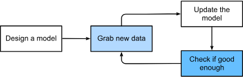

## Definitions
- ML= study of algorithms learning from experience (observational data, environment interactions)

- approach to ML: define a flexible program determining behaviors by params

- fixed params -> program= model

- model family = distinct programs (I-O mappings) producing by manipulating params 

- learning algorithm= meta-program using the dataset to **choose params** 

## Key components 

1. Data
- features= input (special: target= output)
- can be varying-length
- mistaken -> poor predictive performance, un-/under-represented groups (bias)

2. Models
