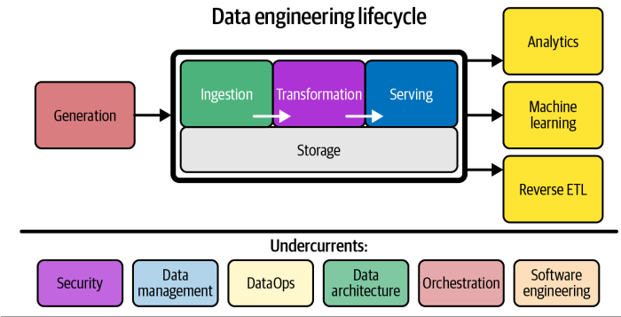

# DE 
- development, implementation & maintenance of systems & processes
- take in raw data -> produce high-quality & consistent info 
- support downstream tasks (analysis & ML)

#### DE skills & activities
- optimize along costs, agility, scalability, simplicity, reusability, interoperability

## Big Data (7 V's)

| V's | Definition| Impact|
|---|---|---|
|Volume| amount of data| management & transformation decision|
|Velocity| how quickly data comes in & made use of | data pipeline efficiency |
|Variety| different data types, formats, sources| data consistency (-> data transformation process)|
|Veracity| source trustworthiness & info reliability| business goal, data processing, data management| 
|Value| essential info (VS nice-to-have) | business decision |
|Visualization| data representation | business decision|
|Variability| different data behaviors over time (types, speed, info) | data processing|

## Generation: Source Systems
- changes -> break pipeline & analytics

#### Key considerations

| W's|| V's|
|---|---|---|
|WHAT?| source characteristics| Volume, Variety |
| | data persistence: long-term, temporary, quicky deleted|Volume, Variety |
| | generation rate (time, speed) | Volume, Velocity|
| | data consistency (unexpected nulls, formatting)| Veracity|
| | schema design | Variety|
| | data duplication| Veracity|
| | error occurence frequency| Veracity|
|HOW? | pulling frequency| Velocity|
| | latency| Velocity|
| | stateful systems: data= periodic snapshots or change data capture events?| Velocity, Variability|
| | impact of data reading on its performance| Volume, Velocity|
|DEPENDENCIES| data provider for downstream consumption| Variety, Veracity|
| | characteristics of upstream data dependencies| Variety, Veracity|
|RELIABILITY| data-quality check-in for late/missing data| Velocity, Veracity|
| SCHEMA EVOLUTION | schema change management | Variety, Variability|

- challenging nuance: schema 
    + define hierarchical data organization
    + fixed schema VS schemaless

## Storage
- run across entire data engineering cycle

#### Key considerations

|W's||V's|
|---|---|---|
|HOW?| support write & read speed| Velocity|
|| understand how it works & utilize| Volume, Velocity|
|| ability to retrieve data in the required service-level agreement| Velocity, Value| 
|| maintain master data, golden records, data quality, data lineage for governance| Veracity, Value|
|| handle regulatory compliance & data sovereignty | Veracity, Value|
|| handle future scale| Volume, Velocity|
|WHAT?| downstream bottleneck| Volume, Velocity|
|| metadata capturing (schema evolution, data flows, data lineage)|Variety, Veracity, Value|
|| pure storage solution (object storage)? support complex query patterns?| Volume, Variety, Value|
|| schema flexibility (flexible, schema-agnostic, enforced)|Variety, Variability|

- data access frequency -> retrieval patterns 

|temperature|access frequency|purpose|
|---|---|---|
|hot data|most frequently accessed|fast retrieval|
|lukewarm data| often accessed (every week, month)||
|cold data| seldom queried| retained for compliance/catastrophic failure|

